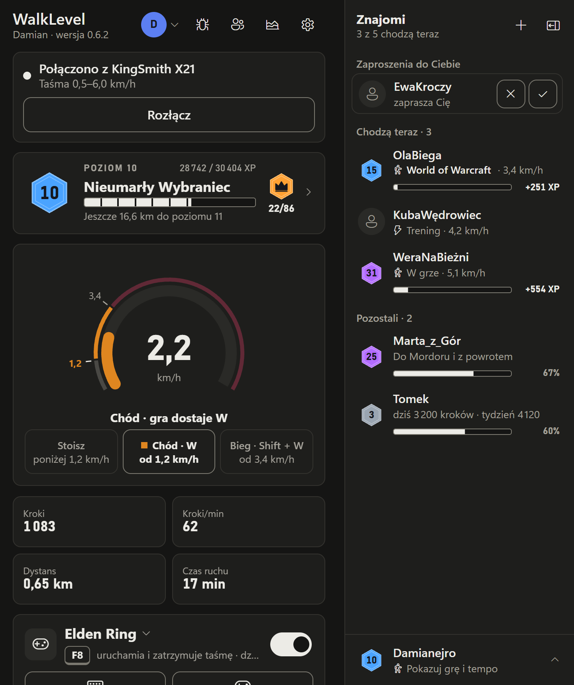
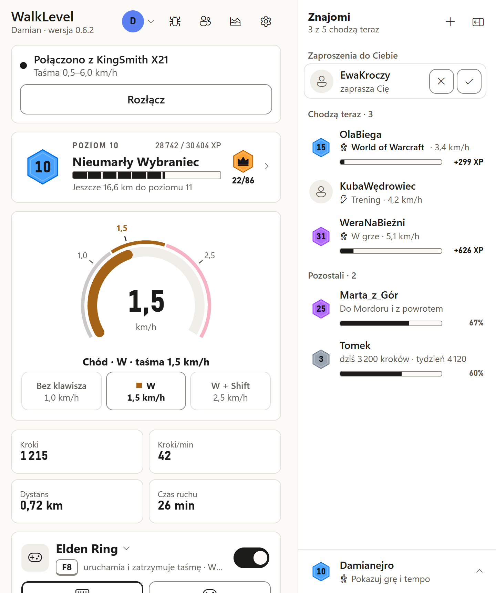
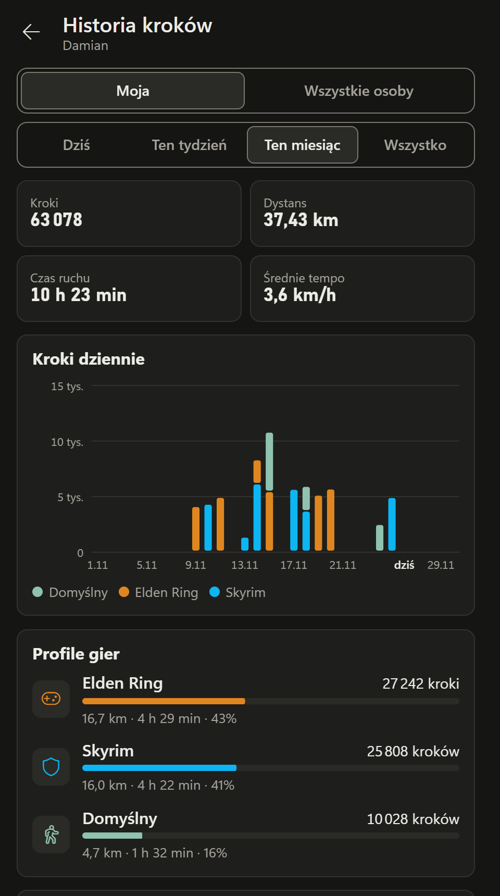
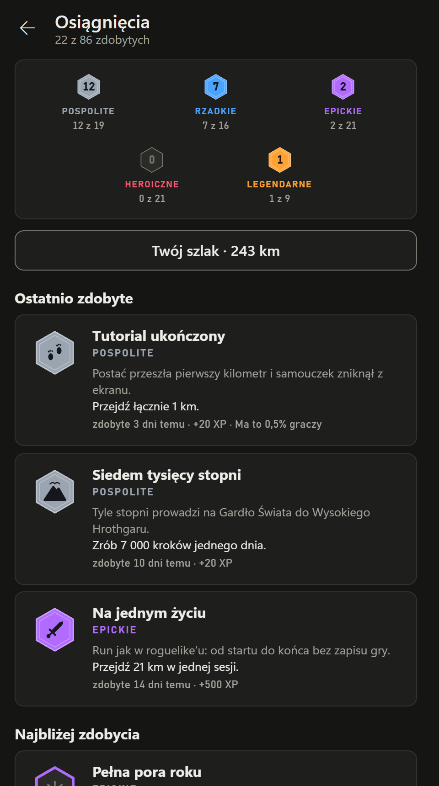
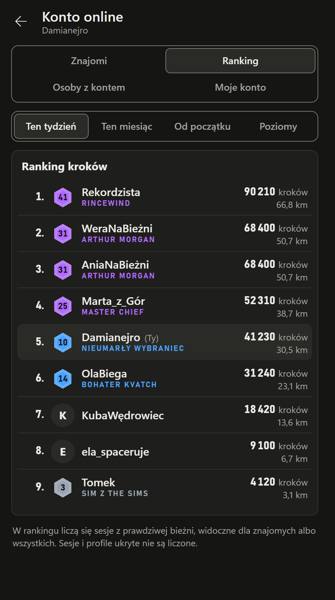
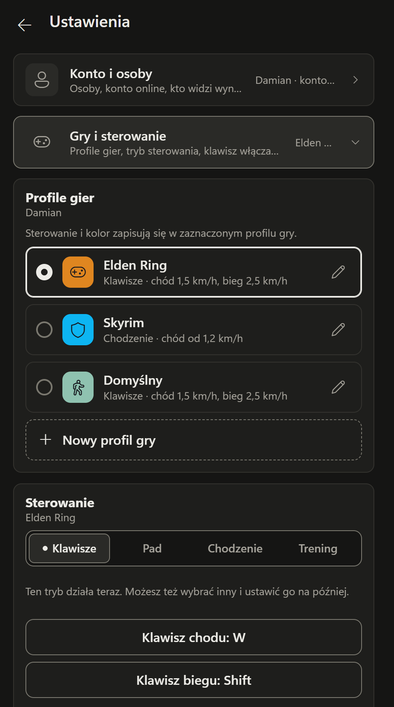

# WalkLevel by damnit.com.pl

English · [Polski](README.pl.md)

[](https://github.com/damnit-damian/WalkLevel-by-damnit.com.pl/releases/latest)
[](https://github.com/damnit-damian/WalkLevel-by-damnit.com.pl/actions/workflows/ci.yml)
[](LICENSE)

Built with [Tauri 2](https://tauri.app) · Rust · [Svelte 5](https://svelte.dev) · TypeScript

*„Chodzisz w realu, idziesz w grze”* (“You walk for real, you go in the game”)

**WalkLevel** is a Windows app that turns walking on a treadmill into game controls: walking is
**W**, running is **Shift + W** (both keys can be changed). It connects to the treadmill over
Bluetooth and finds it on its own. Supported treadmills: **KingSmith WalkingPad** (e.g. X21, X23)
and treadmills with the **Bluetooth FTMS** standard (e.g. **Urevo SpaceWalk 5L**); the model is
detected automatically. There is also a **Trening** (Training) mode, plain treadmill control from
the computer, and an optional **online account** (friends, ranking, results on the account).

The app's interface is in Polish for now; English is planned. Names in bold below are the Polish
labels from the app, with a translation in brackets where it helps.

Author: **damnit.com.pl Damian Skrzypiec** · [damnit.com.pl](https://damnit.com.pl) ·
kontakt@damnit.com.pl

## What it looks like

Screenshots of version 0.6.2 with sample data (people, friends and results are made up).

<table>
  <tr>
    <td width="50%"></td>
    <td width="50%"></td>
  </tr>
  <tr>
    <td>Main screen while walking: belt speed, zone (walk / run), session steps and distance, level with rank. On the right, the friends panel: who is walking now and what they play.</td>
    <td>The same in the light theme, <b>Klawisze</b> (Keys) mode: W and Shift + W set the belt speed.</td>
  </tr>
</table>

<table>
  <tr>
    <td width="25%"></td>
    <td width="25%"></td>
    <td width="25%"></td>
    <td width="25%"></td>
  </tr>
  <tr>
    <td>Step history: daily chart and split by game profile.</td>
    <td>Achievements and the trail.</td>
    <td>Friends ranking in the online account.</td>
    <td>Settings: game profiles and control mode.</td>
  </tr>
</table>

## Installation

1. Download **`WalkLevel-Setup-….exe`** from the [latest release](https://github.com/damnit-damian/WalkLevel-by-damnit.com.pl/releases/latest).
2. Run the installer and click **Instaluj** (Install): one screen, no administrator rights.
   The app opens by itself after installation.
   Windows may show “Windows protected your PC” (the app has no paid publisher certificate):
   click **More info > Run anyway**.
3. Later, open **WalkLevel** from the Start menu or the desktop shortcut.

Requirements: Windows 10 or 11 (64-bit), Bluetooth, Microsoft Edge WebView2 (built into
Windows 11 and up-to-date Windows 10). The installer is about 6 MB.

### First connection to the treadmill

- turn the treadmill on,
- disconnect your phone: close KS Fit or turn off Bluetooth in it (the treadmill accepts one
  connection at a time),
- turn on Bluetooth in Windows (Start > Settings > Bluetooth & devices).

On first start the app searches for the treadmill by itself. If it finds one, it connects right
away and remembers it. If it finds several, it shows a list to choose from.

### First start

A three-step setup: the person's name (randomly drawn: draw again or type your own) and colour,
the first game profile (game folder or the Domyślny (Default) profile), and the control mode
(Klawisze, Pad, Chodzenie or Trening). Updating from 0.5.x keeps everything: the data folder is
the same, so people, profiles, history and the online account stay. After updating from 0.2,
the existing settings go to the first person (a copy of the old settings:
`dane\kopie\ustawienia-0.2.json`).

### People and game profiles

- A **person** has their own game profiles, look and step history. Two people on one treadmill
  count steps separately. To switch person, use the avatar at the top of the window (visible
  when there is more than one person).
- A **game profile** is a set of control settings with a name, icon and colour. New profile:
  Ustawienia > Gry i sterowanie > Nowy profil gry (Settings > Games and control > New game
  profile). Point to the game folder, and the name, icon and colour are taken from the game file
  (you can change the name and colour). To switch profile, click the profile name on the control
  card.
- There is no limit on people or profiles. The person switch on the top bar can be turned off in
  Ustawienia > Wygląd i okno (Settings > Look and window), the profile switch in
  Ustawienia > Gry i sterowanie.

### Usage

| What | How |
| --- | --- |
| Turn control on / off | the switch on the control card or **F8** (works in the game too); the treadmill starts and stops with it |
| **Klawisze** (Keys) mode, default | hold W and the belt speeds up to walking speed, W + Shift to running speed; release and it slows down to the no-key speed (or stops, if set so). The app presses nothing in this mode; you press W in the game yourself |
| **Pad** mode | tilting the left stick (DualSense, DualShock 4 or Xbox pad, cable or Bluetooth) sets the speed in steps: by default 0 / 25 / 50 / 100% = 1 / 1.5 / 2.5 / 4 km/h. The number of steps (2-5), thresholds (drag the circles on the axis) and speeds are in Settings. Stick released: the belt stops (default, moving the stick starts it), step 1 speed or 0 km/h (test) |
| **Chodzenie** (Walking) mode | walking on the treadmill presses W, faster walking presses W + Shift |
| **Trening** (Training) mode | treadmill control without a game: four fixed speeds, chosen with a click or **F7** / **F6**; F8 starts and stops the belt |
| Gauge | zones (stop / walk / run, or pad steps) on the arc and as tokens below it; the active one lights up |
| Control settings | Ustawienia > Gry i sterowanie (Settings > Games and control) shows the settings of the current profile's mode; they are saved in the profile |
| Step history | the chart icon at the top of the window: today / this week / this month / all, mine or everyone's, split by game profile |
| Data backup | Ustawienia > Dane i kopia (Settings > Data and backup): export selected people, profiles, settings, results and logs to a `.bieznia` file; import with a preview (merge or add as a new person). A backup is made before import and can be restored |
| Change the F8 key | Ustawienia > Gry i sterowanie > Klawisz włączania sterowania (Settings > Games and control > Control toggle key); a key combination or a pad button works too; it cannot be the walk or run key |
| Treadmill start and stop | Ustawienia > Bieżnia (Settings > Treadmill), on by default |
| Klawisze w grze: Włączone / Tryb próbny (Keys in game: On / Trial mode) | in Walking mode: trial mode shows what would be pressed but sends nothing to the game; on presses the chosen keys in the active window |
| Change keys | in Ustawienia > Gry i sterowanie click **Klawisz chodu** (Walk key) or **Klawisz biegu** (Run key) and press a new key; Esc cancels |
| Test without a treadmill | Ustawienia > Bieżnia > Symulator bieżni (Settings > Treadmill > Treadmill simulator), then **F7** faster, **F6** slower; simulator sessions give no XP |
| On-screen button | Ustawienia > Wygląd i okno (Settings > Look and window): a small always-on-top button; click turns control on and off, right click opens the window |

Control always starts **off**. When the treadmill stops sending data (3 s), the character stops.
Turning control off first releases the keys (the character stops at once), then stops the belt.
Closing the app with control on also stops the belt. If the treadmill does not accept start,
wake it with the remote or check the safety key.

### Updates

When a new version is out, click the **Aktualizuj** (Update) icon (down arrow) at the top of the
window or Ustawienia > Pomoc i diagnostyka > Sprawdź aktualizacje (Settings > Help and
diagnostics > Check for updates). The app downloads
the installer from GitHub, checks its checksum, installs it and restarts. Settings and logs stay.
Nothing is downloaded or installed without a click.

### When something does not work

Click **Zgłoś problem** (Report a problem, the icon at the top of the window), describe what
happened and send it. The report includes the app and Bluetooth logs; the window shows exactly
what will be attached. The report goes through the server straight to the author's inbox (the
server does not keep it), and you get a report number back. The package can also be saved to disk.
Detailed Bluetooth logs are on by default and can be turned off in Ustawienia > Pomoc
i diagnostyka > Szczegółowy dziennik Bluetooth (Settings > Help and diagnostics > Detailed
Bluetooth log).

For connection problems, **Ustawienia > Pomoc i diagnostyka > Dziennik zdarzeń > Zapisz raport
diagnostyczny** (Settings > Help and diagnostics > Event log > Save diagnostic report, about
30 s) also helps: a list of nearby devices and the raw conversation with the treadmill. The
report is attached to the next problem report by itself.

### Games

- If a game runs as administrator, Windows does not let a normal app press keys in it.
- Games with anti-cheat protection may treat artificially pressed keys as automation. Use it in
  games that allow it, at your own risk.

### Uninstalling

Windows Settings > Apps > WalkLevel > Uninstall. People, profiles, step history and logs stay in
`%LOCALAPPDATA%\Bieznia`; delete that folder if you want to remove everything.

## Levels and achievements

Every kilometre on the treadmill is 100 XP. Levels 1-100 have 39 ranks: characters from games,
fantasy and science fiction, from those who walked the least to those who walked the most. Level 100 comes after
about 5 years at 5 km a day. Achievements (86) come in five tiers: common, rare, epic, heroic and
legendary, and each one adds XP by its tier. Most of them (65) form a distance trail through
worlds from games and books. The rest are for long sessions, steps in a day, day streaks (at
least 2 km a day; one day off in 7 does not break a streak), different games and many kilometres
in one game, Training mode, early and late sessions, and friends in the online account. Only
treadmill sessions count, not the simulator, including past sessions from the whole history. An
achievement, once earned, is never taken away.

New achievements and level-ups pop up in the bottom right corner of the screen, also over the
game. They do not take focus, and clicks go through to the game. Turn them off in Settings
(Poziomy i powiadomienia, Levels and notifications). A game in exclusive full screen may cover
them; the reward then waits in the achievements list.

Updating from an older version keeps everything: people, profiles and the whole history stay,
and the level and achievements are calculated from it on first start.

## Privacy

The app has no ads and no analytics. Treadmill data, step history and logs stay on the computer.
It connects to the internet to check for and download updates or treadmill profiles from GitHub,
when you send a report yourself, and, only if you create an online account, to the account
server.
Details: [Privacy policy](PRIVACY.md) and
[Online account terms and privacy](https://bieznia.damnit-live.pl/bieznia) (in Polish).

## For developers

Since 0.6.0 WalkLevel is Tauri 2 + Svelte 5 + Rust, in the repository root. The architecture
and project rules are in [docs/architecture.md](docs/architecture.md), contribution rules in
[CONTRIBUTING.md](CONTRIBUTING.md). You need
Rust (stable), Node.js 24 (runs the `.ts` scripts directly) and WebView2.

```powershell
npm ci
npm run dev                                  # UI in the browser with a mock core
npx tauri dev                                # the app with the real core
cargo clippy --workspace --all-targets --locked -- -D warnings
cargo test --workspace --locked
npm run check; npm run test:ui               # types and the view test (Edge)
.\packaging\build.ps1 -Version 0.6.3          # exe + installer (needs Inno Setup)
```

### Releasing a new version

```powershell
git tag -a v0.6.3 -F notes.txt               # release notes: English, Polish below
git push origin v0.6.3
```

GitHub Actions runs the tests, builds the exe and the installer (`packaging/build.ps1`, Inno
Setup), signs the installer with the author's key ([docs/release-signing.md](docs/release-signing.md)),
adds a provenance attestation and publishes the release with the notes from the tag.
The app finds it with the **Aktualizuj** (Update) button.

### Layout

- `crates/core` - the whole core without UI: treadmill (KingSmith, FTMS, Bluetooth), control and
  keys, history (SQLite `dane/historia.db`), people and profiles (`dane/osoby.json`), levels and
  achievements, online account and sync, `.bieznia` backups, reports, updates
- `crates/core/assets/profile` - treadmill model profiles (JSON); the app also downloads new
  models from here
- `src-tauri` - Tauri windows, commands and events
- `src` - Svelte UI, `docs` - architecture, contract, look, texts, analyses
- `tests-ui` - view test and text dictionary generator
- `tools` - helper scripts (server definitions file)
- `packaging` - icon, images and the Inno Setup installer script

### Reports straight to the author

**Zgłoś problem** (Report a problem) sends to the address from `config.toml` (section
`[zgloszenia]`, `adres`): POST `multipart/form-data` with the fields `wersja`, `opis` (up to 4000
characters), `kontakt` (up to 200) and the file `paczka` (ZIP, up to 2 MB), User-Agent header
`Bieznia/<version>`. The response `{"id": "..."}` is the report number. An empty address means
an email to kontakt@damnit.com.pl with the log package.

### How the X21 connection works

The X21 speaks its own encrypted KingSmith protocol (described in the open driver
[QZ / qdomyos-zwift](https://github.com/cagnulein/qdomyos-zwift)): service `0x1234`, writes to
`FED7`, notifications from `FED8`, base64 text with a substitution table. Treadmills differ in
the table (7 variants); the app detects it from the treadmill's replies and never reports speed
from a frame it could not decode with certainty. Speed is polled every 0.75 s, because at a
steady pace the treadmill may send nothing by itself; when it does send data on its own, the
app polls every 2 s. Start is `props ControlMode 1` + `props runState 1` (up to four attempts
when the treadmill does not accept it), stop is
`props runState 0`, speed is `props CurrentSpeed 1.5` (as in QZ). The FTMS standard (e.g. Urevo
SpaceWalk) is supported too, with speed reading and control.

## Security

- updates only after a click and only from this repository's releases
  (`github.com/damnit-damian/WalkLevel-by-damnit.com.pl/releases/download/…` and the GitHub
  download servers it redirects to); the installer runs only after the SHA-256 checksum given by
  GitHub matches and its signature by the author's key checks out (`.sig`,
  [docs/release-signing.md](docs/release-signing.md)),
- releases are built in GitHub Actions from pinned versions (actions by commit, Inno Setup by
  SHA-256, libraries from `Cargo.lock` and `package-lock.json`) and have a provenance attestation
  (`gh attestation verify WalkLevel-Setup-….exe --repo damnit-damian/WalkLevel-by-damnit.com.pl`),
- installation and operation without administrator rights; the app starts with control off,
  sends the treadmill only start, stop and speed (when control is on) and releases W/Shift after
  losing data, a crash or closing,
- shortcuts (the control toggle key and the faster / slower keys, by default F8, F7 and F6) are
  checked globally, but the program does not read or write any other keys.

## License

© 2026 damnit.com.pl Damian Skrzypiec. Licensed under GPL-3.0-or-later, see [LICENSE](LICENSE).
The KingSmith protocol was reconstructed from the driver in the
[QZ (qdomyos-zwift)](https://github.com/cagnulein/qdomyos-zwift) project, also under GPL-3.0.

## Acknowledgements

Velczer - the originator of the idea and the main tester of WalkLevel.
