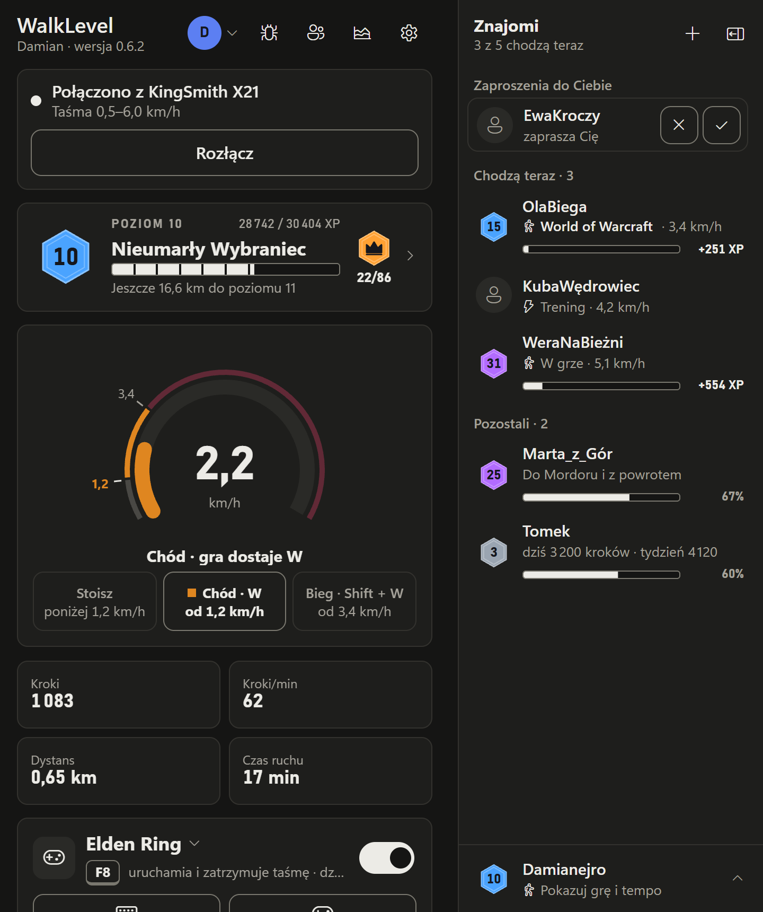
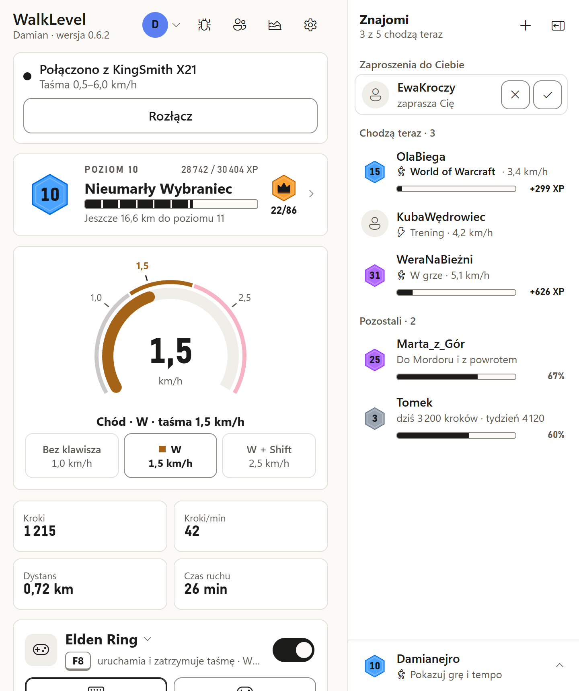
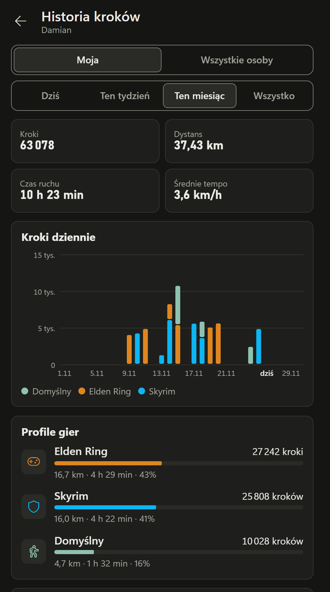
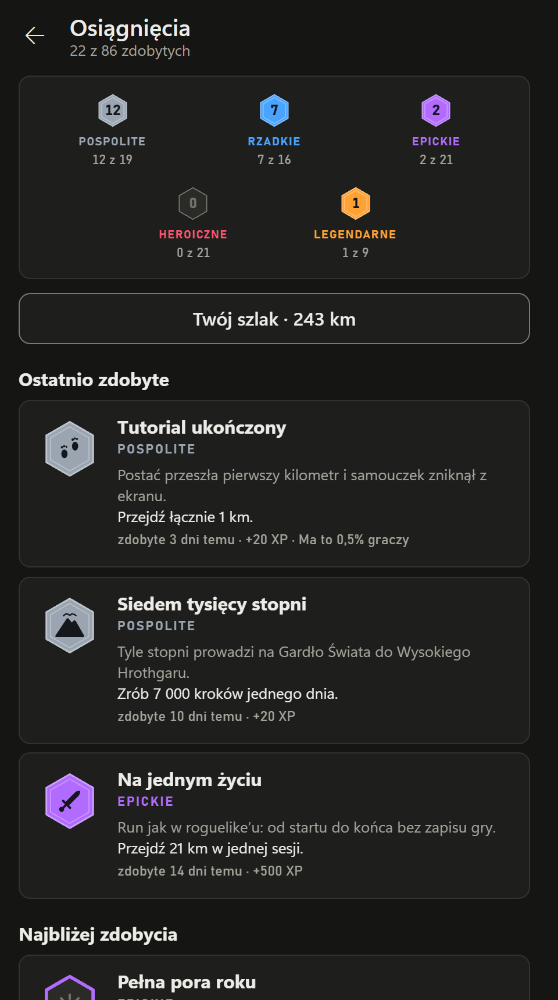
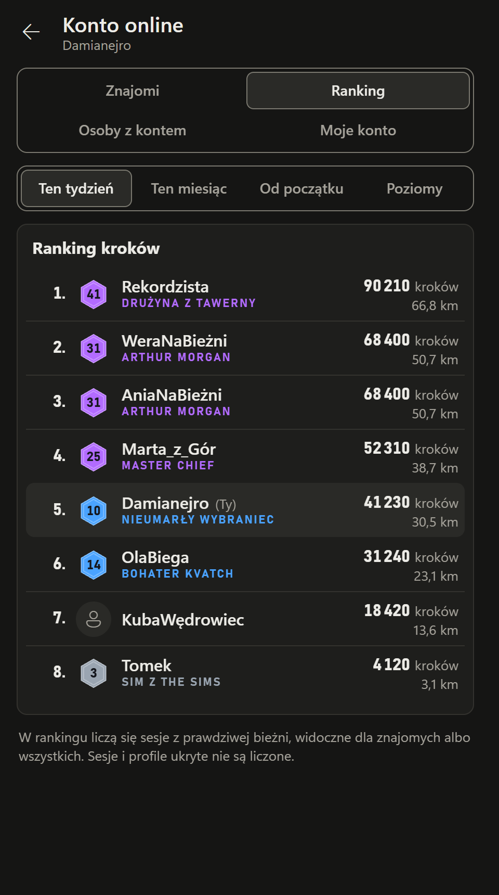
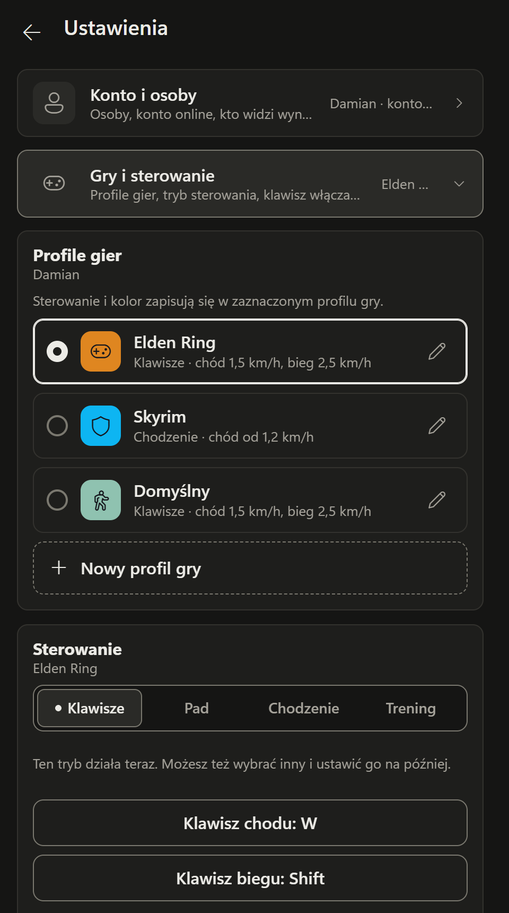

# WalkLevel by damnit.com.pl

[English](README.md) · Polski

[](https://github.com/Damianejroo/WalkLevel-by-damnit.com.pl/releases/latest)
[](https://github.com/Damianejroo/WalkLevel-by-damnit.com.pl/actions/workflows/ci.yml)
[](LICENSE)

Zbudowane w [Tauri 2](https://tauri.app) · Rust · [Svelte 5](https://svelte.dev) · TypeScript

*„Chodzisz w realu, idziesz w grze”*

**WalkLevel** to aplikacja na Windows, która zamienia chodzenie po bieżni na sterowanie
w grach: chód to **W**, bieg to **Shift + W** (oba klawisze można zmienić). Łączy się z bieżnią przez Bluetooth i sama ją
wyszukuje. Obsługiwane bieżnie: **KingSmith WalkingPad** (np. X21, X23) i bieżnie ze standardem **Bluetooth FTMS**
(np. **Urevo SpaceWalk 5L**); model rozpoznaje sama. Jest też tryb **Trening** (zwykłe sterowanie bieżnią z komputera)
i opcjonalne **konto online** (znajomi, ranking, wyniki na koncie).

Twórca: **damnit.com.pl Damian Skrzypiec** · [damnit.com.pl](https://damnit.com.pl) ·
kontakt@damnit.com.pl

## Jak wygląda

Zrzuty wersji 0.6.2 z przykładowymi danymi (osoby, znajomi i wyniki są wymyślone).

<table>
  <tr>
    <td width="50%"></td>
    <td width="50%"></td>
  </tr>
  <tr>
    <td>Ekran główny podczas chodzenia: prędkość taśmy, strefa (chód / bieg), kroki i dystans sesji, poziom z rangą. Z prawej panel znajomych - kto chodzi teraz i w co gra.</td>
    <td>To samo w jasnym motywie, tryb <b>Klawisze</b>: W i Shift + W ustawiają prędkość taśmy.</td>
  </tr>
</table>

<table>
  <tr>
    <td width="25%"></td>
    <td width="25%"></td>
    <td width="25%"></td>
    <td width="25%"></td>
  </tr>
  <tr>
    <td>Historia kroków: wykres dzienny i podział na profile gier.</td>
    <td>Osiągnięcia i szlak.</td>
    <td>Ranking znajomych w koncie online.</td>
    <td>Ustawienia: profile gier i tryb sterowania.</td>
  </tr>
</table>

## Instalacja

1. Pobierz **`Bieznia-Setup-….exe`** z [najnowszego wydania](https://github.com/Damianejroo/WalkLevel-by-damnit.com.pl/releases/latest).
2. Uruchom instalator i kliknij **Instaluj** (jeden ekran, bez administratora). Po instalacji
   aplikacja otworzy się sama.
   Windows może pokazać okno „System Windows ochronił ten komputer” (aplikacja nie ma
   płatnego certyfikatu wydawcy) - kliknij **Więcej informacji > Uruchom mimo to**.
3. Później otwieraj **WalkLevel** z menu Start albo ze skrótu na pulpicie.

Wymagania: Windows 10 lub 11 (64-bit), Bluetooth, Microsoft Edge WebView2 (wbudowany
w Windows 11 i aktualny Windows 10). Instalator ma ok. 6 MB.

### Pierwsze połączenie z bieżnią

- włącz bieżnię,
- rozłącz telefon: zamknij KS Fit albo wyłącz w nim Bluetooth (bieżnia przyjmuje jedno
  połączenie naraz),
- włącz Bluetooth w Windows (Start > Ustawienia > Bluetooth i urządzenia).

Aplikacja przy pierwszym starcie sama szuka bieżni. Jeśli znajdzie jedną, łączy się od razu
i zapamiętuje ją. Jeśli kilka - pokazuje listę do wyboru.

### Pierwsze uruchomienie

Konfigurator w trzech krokach: nazwa osoby (wylosowana - możesz losować dalej albo wpisać
swoją) i jej kolor, pierwszy profil gry (folder gry albo profil Domyślny), sposób sterowania
(Klawisze, Pad, Chodzenie albo Trening). Aktualizacja z 0.5.x niczego nie gubi: folder danych
jest ten sam, więc osoby, profile, historia i konto online zostają. Po aktualizacji z 0.2
dotychczasowe ustawienia trafiają do pierwszej osoby (kopia starych ustawień:
`dane\kopie\ustawienia-0.2.json`).

### Osoby i profile gier

- **Osoba** ma swoje profile gier, wygląd i historię kroków. Dwie osoby na jednej bieżni liczą
  kroki osobno. Zmiana osoby: awatar na górze okna (widoczny, gdy osób jest więcej niż jedna).
- **Profil gry** to zestaw ustawień sterowania z nazwą, ikoną i kolorem. Nowy profil:
  Ustawienia > Gry i sterowanie > Nowy profil gry - wskaż folder gry, a nazwa, ikona i kolor
  wezmą się z pliku gry (nazwę i kolor zmienisz). Zmiana profilu: kliknij nazwę profilu na
  karcie sterowania.
- Liczba osób i profili nie jest ograniczona. Zmianę osoby na górnym pasku można wyłączyć
  w Ustawieniach > Wygląd i okno, zmianę profilu w Ustawieniach > Gry i sterowanie.

### Obsługa

| Co | Jak |
| --- | --- |
| Włącz / wyłącz sterowanie | przełącznik na karcie sterowania albo **F8** (działa też w grze) - razem z tym bieżnia rusza i staje |
| Tryb **Klawisze** (domyślny) | trzymasz W - taśma przyspiesza do prędkości chodu, W + Shift - do biegu, puszczasz - zwalnia do prędkości bez klawisza (albo staje, jeśli tak ustawisz). Aplikacja niczego wtedy nie naciska, W naciskasz sam w grze |
| Tryb **Pad** | wychylenie lewej gałki (DualSense, DualShock 4 albo pad Xbox, kabel lub Bluetooth) ustawia prędkość skokami: domyślnie 0 / 25 / 50 / 100% = 1 / 1,5 / 2,5 / 4 km/h. Liczba skoków (2-5), progi (przeciąganie kółek na osi) i prędkości w Ustawieniach. Gałka puszczona: taśma staje (domyślnie, ruch gałki ją uruchamia), tempo stopnia 1 albo 0 km/h (próba) |
| Tryb **Chodzenie** | chodzenie po bieżni naciska W, szybszy chód W + Shift |
| Tryb **Trening** | sterowanie bieżnią bez gry: cztery stałe tempa, wybierane kliknięciem albo **F7** / **F6**; F8 uruchamia i zatrzymuje taśmę |
| Wskaźnik | strefy (stop / chód / bieg albo skoki pada) na łuku i jako żetony pod nim - świeci aktywna |
| Ustawienia sterowania | Ustawienia > Gry i sterowanie pokazują ustawienia trybu bieżącego profilu; zapisują się w profilu |
| Historia kroków | ikona wykresu na górze okna: dziś / ten tydzień / ten miesiąc / wszystko, moja albo wszystkich osób, podział na profile gier |
| Kopia danych | Ustawienia > Dane i kopia: eksport wybranych osób, profili, ustawień, wyników i logów do pliku `.bieznia`; import z podglądem (połącz albo dodaj jako nową osobę). Przed importem robi się kopia, którą można przywrócić |
| Zmiana klawisza F8 | Ustawienia > Gry i sterowanie > Klawisz włączania sterowania; działa też kombinacja klawiszy albo przycisk pada (nie może to być klawisz chodu ani biegu) |
| Start i stop bieżni | Ustawienia > Bieżnia (domyślnie włączone) |
| Klawisze w grze: Włączone / Tryb próbny | w trybie Chodzenie: tryb próbny pokazuje, co aplikacja by nacisnęła, ale gra nic nie dostaje; włączone naciska wybrane klawisze w aktywnym oknie |
| Zmiana klawiszy | w Ustawienia > Gry i sterowanie kliknij **Klawisz chodu** albo **Klawisz biegu** i naciśnij nowy klawisz; Esc anuluje |
| Test bez bieżni | Ustawienia > Bieżnia > Symulator bieżni, potem **F7** szybciej, **F6** wolniej; sesje z symulatora nie dają XP |
| Przycisk na ekranie | Ustawienia > Wygląd i okno: mały przycisk zawsze na wierzchu - klik włącza i wyłącza sterowanie, prawy przycisk otwiera okno |

Sterowanie startuje zawsze **wyłączone**. Gdy bieżnia przestanie wysyłać dane (3 s), postać
się zatrzymuje. Wyłączenie sterowania najpierw puszcza klawisze (postać staje od razu), potem
zatrzymuje taśmę. Zamknięcie aplikacji przy włączonym sterowaniu też zatrzymuje taśmę.
Gdy bieżnia nie przyjmie startu, obudź ją pilotem albo sprawdź klucz bezpieczeństwa.

### Aktualizacje

Gdy wyjdzie nowa wersja, kliknij ikonę **Aktualizuj** (strzałka w dół) na górze okna albo
Ustawienia > Pomoc i diagnostyka > Sprawdź aktualizacje. Aplikacja pobierze instalator z GitHuba, sprawdzi jego sumę kontrolną,
zainstaluje go i uruchomi się ponownie. Ustawienia i logi zostają. Bez kliknięcia nic się
nie pobiera ani nie instaluje.

### Gdy coś nie działa

Kliknij **Zgłoś problem** (ikona na górze okna), opisz, co się stało, i wyślij. Do zgłoszenia
trafiają logi aplikacji i Bluetooth - okno pokazuje dokładnie, co zostanie dołączone.
Zgłoszenie idzie przez serwer prosto na skrzynkę autora (serwer go nie przechowuje),
a w odpowiedzi dostajesz numer zgłoszenia. Paczkę można też zapisać na dysk.
Szczegółowe logi Bluetooth są domyślnie włączone; wyłączysz je w Ustawienia > Pomoc
i diagnostyka > Szczegółowy dziennik Bluetooth.

Przy problemach z połączeniem pomaga też **Ustawienia > Pomoc i diagnostyka > Dziennik
zdarzeń > Zapisz raport diagnostyczny** (ok. 30 s): lista urządzeń w pobliżu i surowa rozmowa
z bieżnią. Raport sam dołącza się do następnego zgłoszenia.

### Gry

- Jeśli gra działa jako administrator, Windows nie pozwoli zwykłej aplikacji naciskać w niej
  klawiszy.
- Gry z ochroną przed oszustwami mogą traktować sztucznie naciskane klawisze jak
  automatyzację. Używaj w grach, które na to pozwalają, na własną odpowiedzialność.

### Odinstalowanie

Ustawienia Windows > Aplikacje > WalkLevel > Odinstaluj. Osoby, profile, historia kroków i logi zostają w
`%LOCALAPPDATA%\Bieznia` - usuń ten folder, jeśli chcesz pozbyć się wszystkiego.

## Poziomy i osiągnięcia

Każdy kilometr na bieżni to 100 XP. Poziomy 1-100 mają 39 rang - postaci z gier i książek,
od tych, które chodziły najmniej, po te, które przeszły najwięcej. Poziom 100 wypada po ok. 5 latach
przy 5 km dziennie. Osiągnięcia (86) mają pięć stopni: pospolite, rzadkie, epickie, heroiczne
i legendarne, a każde dodaje XP zależnie od stopnia. Większość (65) to szlak dystansu przez
światy z gier i książek. Reszta jest za długie sesje, kroki w ciągu dnia, serie dni (min. 2 km
dziennie; jeden dzień wolny na 7 nie przerywa serii), różne gry i wiele kilometrów w jednej grze,
tryb Trening, sesje wczesne i późne oraz znajomych w koncie online. Liczą się sesje z bieżni, bez
symulatora, także wstecz z całej historii. Raz zdobytego osiągnięcia aplikacja nie odbiera.

Nowe osiągnięcia i awanse wyskakują w prawym dolnym rogu ekranu, także nad grą - nie zabierają
fokusu, a kliknięcia przechodzą do gry. Wyłączysz je w Ustawieniach (Poziomy i powiadomienia).
Gra w trybie wyłącznego pełnego ekranu może je przykryć; wtedy zdobycz czeka na liście osiągnięć.

Aktualizacja ze starszej wersji przechodzi bez zmian: osoby, profile i cała historia zostają,
a poziom i osiągnięcia liczą się z niej przy pierwszym uruchomieniu.

## Prywatność

Aplikacja nie ma reklam ani analityki. Dane z bieżni, historia kroków i logi zostają na komputerze.
Z internetem łączy się, żeby sprawdzić i pobrać aktualizację albo profile bieżni z GitHuba, gdy sam
wyślesz zgłoszenie, oraz - tylko jeśli założysz konto online - z serwerem kont.
Szczegóły: [Polityka prywatności](PRIVACY.pl.md) i
[Regulamin i prywatność konta online](https://bieznia.damnit-live.pl/bieznia).

## Dla programisty

WalkLevel od 0.6.0 to Tauri 2 + Svelte 5 + Rust, w katalogu głównym repozytorium. Architektura
i zasady projektu są w [docs/architecture.pl.md](docs/architecture.pl.md), zasady współpracy
w [CONTRIBUTING.pl.md](CONTRIBUTING.pl.md).
Potrzebne: Rust (stable), Node.js 24 (uruchamia skrypty `.ts` bez kompilacji), WebView2.

```powershell
npm ci
npm run dev                                  # interfejs w przeglądarce z atrapą rdzenia
npx tauri dev                                # aplikacja z prawdziwym rdzeniem
cargo clippy --workspace --all-targets --locked -- -D warnings
cargo test --workspace --locked
npm run check; npm run test:ui               # typy i test widoków (Edge)
.\packaging\build.ps1 -Version 0.6.3          # exe + instalator (wymaga Inno Setup)
```

### Wydanie nowej wersji

```powershell
git tag -a v0.6.3 -F opis.txt                # opis wydania: po angielsku, pod nim po polsku
git push origin v0.6.3
```

GitHub Actions uruchamia testy, buduje exe i instalator (`packaging/build.ps1`,
Inno Setup), dodaje poświadczenie pochodzenia i publikuje wydanie z opisem z tagu. Aplikacja
znajdzie je przyciskiem **Aktualizuj**.

### Struktura

- `crates/core` - cały rdzeń bez interfejsu: bieżnia (KingSmith, FTMS, Bluetooth),
  sterowanie i klawisze, historia (SQLite `dane/historia.db`), osoby i profile
  (`dane/osoby.json`), poziomy i osiągnięcia, konto online i synchronizacja, kopie `.bieznia`,
  zgłoszenia, aktualizacje
- `crates/core/assets/profile` - profile modeli bieżni (JSON); stąd aplikacja
  pobiera też nowe modele
- `src-tauri` - okna, komendy i zdarzenia Tauri
- `src` - interfejs Svelte, `docs` - architektura, kontrakt, wygląd, teksty, analizy
- `tests-ui` - test widoków i generator słownika tekstów
- `tools` - skrypty pomocnicze (plik definicji dla serwera)
- `packaging` - ikona, grafiki i skrypt instalatora Inno Setup

### Zgłoszenia prosto do autora

**Zgłoś problem** wysyła na adres z `config.toml` (sekcja `[zgloszenia]`, `adres`):
POST `multipart/form-data` z polami `wersja`, `opis` (do 4000 znaków), `kontakt` (do 200)
i plikiem `paczka` (ZIP, do 2 MB), nagłówek User-Agent `Bieznia/<wersja>`. Odpowiedź
`{"id": "..."}` to numer zgłoszenia. Pusty adres = e-mail na kontakt@damnit.com.pl
z paczką logów.

### Jak działa połączenie z X21

X21 mówi własnym, szyfrowanym protokołem KingSmith (opisanym w otwartym sterowniku
[QZ / qdomyos-zwift](https://github.com/cagnulein/qdomyos-zwift)): usługa `0x1234`, zapis do
`FED7`, powiadomienia z `FED8`, tekst w base64 z tablicą podstawień. Bieżnie różnią się
tablicą (7 wariantów) - aplikacja wykrywa ją z odpowiedzi bieżni i nigdy nie podaje prędkości
z niepewnie odszyfrowanej ramki. Prędkość jest odpytywana co 0,75 s, bo przy stałym tempie
bieżnia może sama nic nie wysyłać; gdy wysyła dane sama, aplikacja pyta co 2 s. Start to
`props ControlMode 1` + `props runState 1` (do czterech prób, gdy bieżnia go nie przyjmie), stop to `props runState 0`, prędkość to `props CurrentSpeed 1.5` (jak w QZ). Obsługiwany jest też
standard FTMS (np. Urevo SpaceWalk), z odczytem i sterowaniem prędkością.

## Bezpieczeństwo

- aktualizacja tylko po kliknięciu, tylko z wydań tego repozytorium i tylko z hostów GitHuba;
  instalator jest uruchamiany dopiero po zgodności sumy SHA-256 podanej przez GitHub,
- wydania budują się w GitHub Actions z przypiętych wersji (akcje po commitach, Inno Setup
  po sumie SHA-256, biblioteki z `Cargo.lock` i `package-lock.json`) i mają poświadczenie pochodzenia
  (`gh attestation verify Bieznia-Setup-….exe --repo Damianejroo/WalkLevel-by-damnit.com.pl`),
- instalacja i działanie bez administratora; aplikacja startuje z wyłączonym sterowaniem,
  wysyła do bieżni tylko start, stop i prędkość (gdy sterowanie jest włączone) i puszcza W/Shift po utracie
  danych, awarii albo zamknięciu,
- skróty (klawisz włączania sterowania oraz klawisze szybciej i wolniej, domyślnie F8, F7 i F6)
  są sprawdzane globalnie, ale program nie czyta ani nie zapisuje innych klawiszy.

## Licencja

© 2026 damnit.com.pl Damian Skrzypiec. Licencja GPL-3.0-or-later - zobacz [LICENSE](LICENSE).
Protokół KingSmith odtworzony na podstawie sterownika z projektu
[QZ (qdomyos-zwift)](https://github.com/cagnulein/qdomyos-zwift), również na licencji GPL-3.0.

## Podziękowania

Velczer - pomysłodawca i główny tester WalkLevel.
